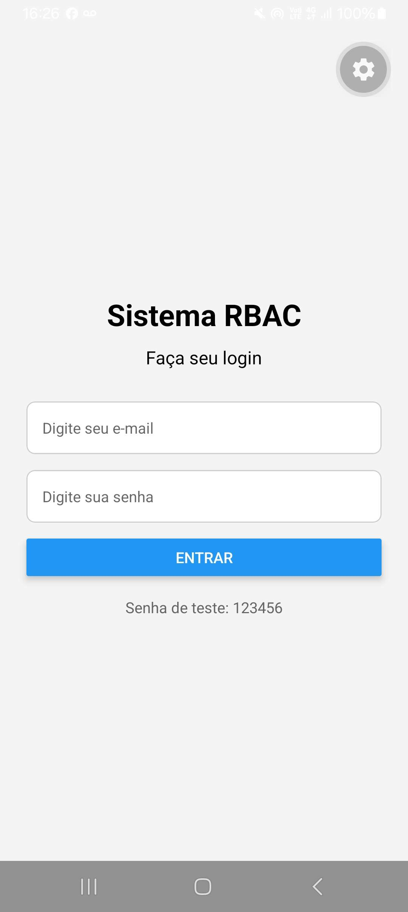
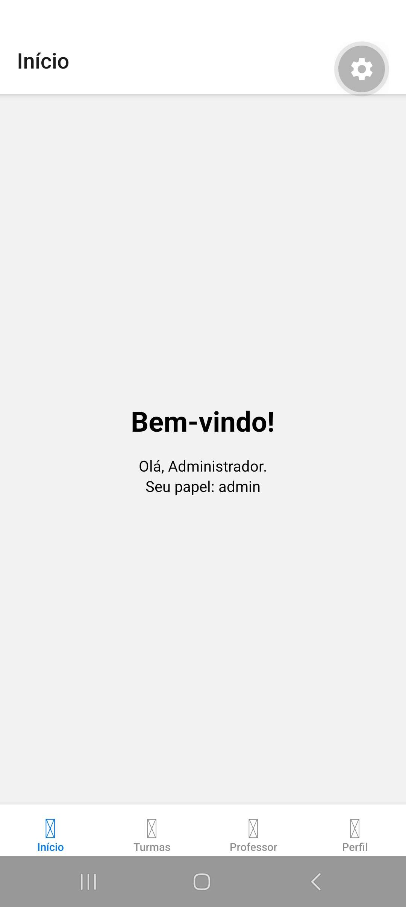
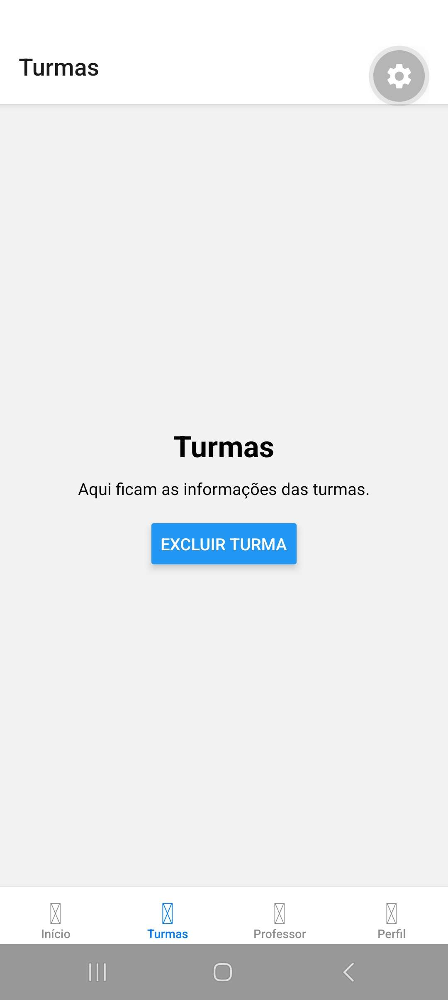
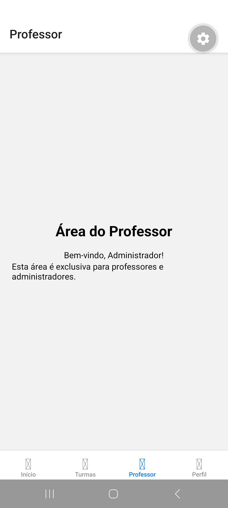
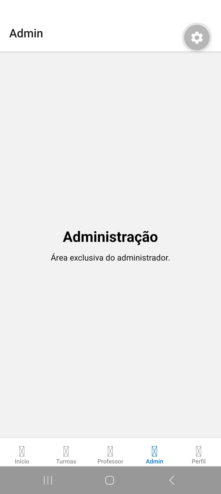
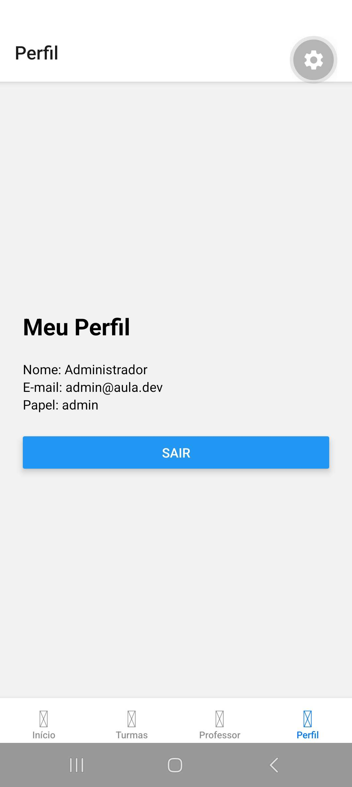

# RBAC no SIEP — Sistema de Controle de Acesso

## 1. Sobre o projeto

Este projeto foi desenvolvido como atividade prática da disciplina de Programação para Dispositivos Móveis.

O objetivo é estudar e implementar o controle de acesso baseado em cargos e permissões (RBAC — Role-Based Access Control), utilizando como referência o Sistema Integrado de Ensino e Pesquisa (SIEP).

O trabalho está dividido em duas partes:
- Questões teóricas sobre o funcionamento do RBAC no SIEP.
- Desenvolvimento de um aplicativo utilizando React Native, TypeScript e Expo.

# PARTE 1 — QUESTÕES TEÓRICAS

## Questão 1 — Estrutura do banco de dados

Para implementar o RBAC, o banco de dados pode utilizar tabelas como:

- `users`: armazena os dados dos usuários.
- `internal_users`: identifica os usuários internos do sistema.
- `positions`: armazena os cargos ou funções dos usuários.
- `permissions`: registra as permissões disponíveis.
- `position_permissions`: relaciona os cargos às permissões.
- Tabelas de unidades: armazenam as informações das unidades às quais os usuários estão vinculados.

Essa estrutura permite organizar os usuários, seus cargos e as permissões de acesso.

## Questão 2 — Diferença entre RolesGuard e hasPermission

O `RolesGuard` verifica se o usuário possui um determinado cargo ou tipo de acesso para entrar em uma rota.

Já o `hasPermission` verifica se o usuário possui autorização para executar uma ação específica dentro do sistema.

Assim, o primeiro controla o acesso às rotas, enquanto o segundo controla as ações que podem ser realizadas.

## Questão 3 — Diferença entre os erros 401 e 403

O erro HTTP 401 (Unauthorized) acontece quando o usuário não está autenticado ou apresenta um token inválido.

O erro HTTP 403 (Forbidden) acontece quando o usuário está autenticado, mas não possui autorização para acessar determinado recurso ou executar uma ação.

## Questão 4 — Vantagem de armazenar permissões no banco de dados

Armazenar permissões no banco de dados oferece maior flexibilidade, pois permite adicionar, remover ou modificar permissões sem precisar alterar o código do sistema.

Se as permissões fossem definidas diretamente em um enum, seria necessário modificar o código sempre que surgisse uma nova permissão.

## Questão 5 — Responsabilidade do Use Case

O Use Case é responsável por executar as regras de negócio da aplicação.

Por isso, ele também deve verificar permissões mais específicas, garantindo que o usuário tenha autorização para realizar determinada operação.

Essa verificação complementa a proteção das rotas.

## Questão 6 — Escopos de acesso

Os escopos determinam quais registros um usuário pode visualizar ou modificar.

Por exemplo:

- `own_unit`: permite acessar somente informações da própria unidade.
- `unit_type`: permite acessar informações de unidades de um determinado tipo.

Essas regras ajudam a restringir o acesso de acordo com a responsabilidade de cada usuário.

## Questão 7 — Utilização do erro 404

O erro 404 (Not Found) pode ser utilizado quando um usuário tenta acessar um registro que está fora do seu escopo de autorização.

Dessa maneira, o sistema evita revelar a existência de informações às quais o usuário não deveria ter acesso.

## Questão 8 — Problema de não verificar as permissões

Se o sistema não comparar as permissões do usuário com as exigências do Use Case, poderá permitir operações não autorizadas.

Por isso, é necessário verificar se o usuário possui a permissão exigida antes de executar a operação.

## Questão 9 — Comportamento de configurações ausentes

Quando a configuração `visibility_scope` não está definida, o sistema utiliza o valor padrão `all`, permitindo a visualização de todos os registros conforme essa configuração.

Já quando a anotação `@Roles` não está presente em uma rota protegida, o acesso deve ser negado, retornando o erro 403.

## Questão 10 — Problema de permissões desatualizadas

Quando um usuário tem suas permissões modificadas, mas ainda utiliza um token ou cookie com informações antigas, a interface pode continuar mostrando opções que já não deveriam estar disponíveis.

Entretanto, quando a operação chega à API, a autorização atualizada deve ser verificada. Caso o usuário não tenha mais permissão, a API deve retornar erro 403.

## Questão 11 — Por que esconder um botão não é suficiente?

Esconder um botão na interface não garante a segurança do sistema, pois um usuário pode tentar executar a operação por outros meios, como uma requisição direta à API.

Por isso, além de ocultar as funcionalidades na interface, o servidor também precisa verificar as permissões antes de executar qualquer operação.

# PARTE 2 — DESENVOLVIMENTO PRÁTICO

## 2. Tecnologias utilizadas

- React Native
- TypeScript
- Expo
- Expo Router
- Expo SecureStore

## 3. Funcionalidades desenvolvidas

- Autenticação de usuários por e-mail e senha.
- Controle de acesso por cargos.
- Proteção de telas e abas de navegação.
- Controle de permissões para executar ações.
- Persistência de sessão utilizando SecureStore.
- Encerramento de sessão por meio do logout.

## 4. Cargos dos usuários

| Cargo | Acesso |
|---|---|
| Aluno | Consultar turmas |
| Monitor | Consultar turmas |
| Professor | Consultar e excluir turmas |
| Administrador | Consultar turmas, excluir turmas e acessar a área administrativa |

## 5. Usuários para teste

| Usuário | E-mail | Senha |
|---|---|---|
| Aluno | aluno@aula.dev | 123456 |
| Monitor | monitor@aula.dev | 123456 |
| Professor | professor@aula.dev | 123456 |
| Administrador | admin@aula.dev | 123456 |

## 6. Controle de permissões

As permissões são atribuídas de acordo com o cargo do usuário.

| Cargo | Permissões |
|---|---|
| Aluno | `turma.visualizar` |
| Monitor | `turma.visualizar` |
| Professor | `turma.visualizar`, `turma.excluir` |
| Administrador | `turma.visualizar`, `turma.excluir`, `usuario.gerenciar` |

Para verificar se o usuário possui autorização para executar uma ação, foi criada a função `can()`.

Exemplo:

```tsx
can('turma.excluir')
```

Essa função retorna `true` quando o usuário possui a permissão e `false` quando não possui.

Dessa forma, o botão de exclusão de turmas aparece somente para usuários autorizados.

## 7. Persistência de sessão

Foi utilizada a biblioteca Expo SecureStore para armazenar o token de autenticação no dispositivo.

Quando o aplicativo é aberto, ele verifica se existe um token salvo e simula a consulta do usuário correspondente.

Assim, o usuário não precisa realizar login novamente sempre que abrir o aplicativo.

## 8. Proteção de navegação

O Expo Router foi utilizado para controlar o acesso às telas e abas.

Foram utilizados:

- `Stack.Protected`: controla o acesso às rotas de autenticação e às telas internas.
- `Tabs.Protected`: controla quais abas podem aparecer de acordo com o cargo do usuário.

A aba Professor, por exemplo, fica disponível somente para professores e administradores.

## 9. Estrutura do projeto

```text
sistema-rbac/
│
├── app/
│   ├── _layout.tsx
│   ├── sign-in.tsx
│   │
│   └── (app)/
│       ├── _layout.tsx
│       ├── index.tsx
│       ├── turmas.tsx
│       ├── perfil.tsx
│       ├── admin.tsx
│       └── professor.tsx
│
├── src/
│   └── auth/
│       ├── AuthContext.tsx
│       ├── type.ts
│       └── RequireRole.tsx
│
└── README.md
```

## 10. Como executar o projeto

### 1. Clonar o repositório

```bash
git clone URL_DO_REPOSITORIO
```

### 2. Entrar na pasta do projeto

```bash
cd sistema-rbac
```

### 3. Instalar as dependências

```bash
npm install
```

### 4. Iniciar o aplicativo

```bash
npx expo start
```

Após iniciar, utilize o Expo Go ou um emulador Android para executar o aplicativo.

## 11. Prints do aplicativo

Os prints das telas podem ser adicionados nesta seção para demonstrar o funcionamento do projeto.

### Tela de login



### Tela inicial



### Tela de turmas



### Área do professor



### Área administrativa



### Tela de perfil



## 12. Observações

O projeto utiliza dados simulados para representar a autenticação e as permissões dos usuários. Não existe integração com uma API ou banco de dados real.

O token é armazenado localmente por meio do Expo SecureStore, com finalidade demonstrativa e acadêmica.

Em um sistema real, a API também deve validar as permissões dos usuários antes de executar operações, garantindo a segurança das informações.

## 13. Conclusão

O desenvolvimento deste projeto permitiu compreender como funciona o controle de acesso baseado em cargos e permissões.

Por meio da implementação, foi possível aplicar conceitos de autenticação, autorização, proteção de rotas, gerenciamento de permissões e persistência de sessão.

O aplicativo demonstra como diferentes usuários podem ter acessos distintos dentro de um mesmo sistema, contribuindo para a organização e segurança das informações.

## Kauê de Souza Marinho

Desenvolvido como atividade acadêmica da disciplina de Programação para Dispositivos Móveis.
